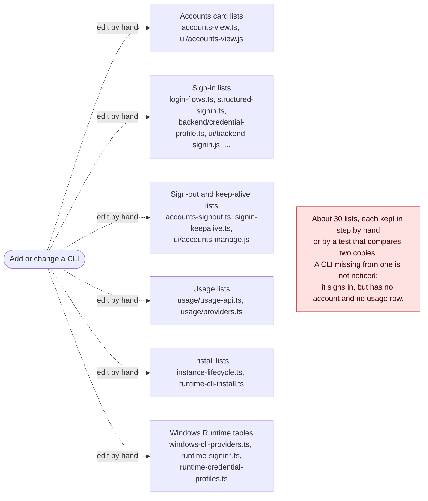
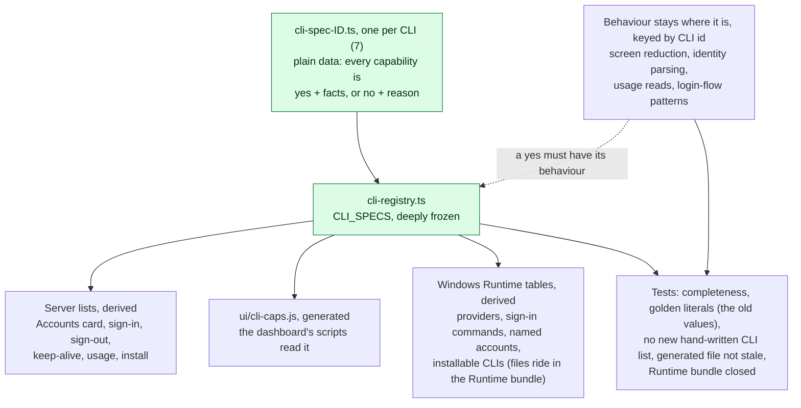

## What

**Why.** What an AI tool (CLI) can do in AgEnD (sign in, show its account, show its usage, sign out, be installed, run on a paired Windows computer) is written out by hand in about thirty lists across the server, the dashboard's scripts and the Windows Runtime. Adding a CLI means remembering every one of them, and a miss shows up as a CLI that signs in but has no account and no usage row, or one that works on the host and not on a paired computer. Several lists exist twice and are kept in step by hand: the host's `CREDENTIAL_HOMES` and the Runtime's `CREDENTIAL_PROFILE_CLIS`, or the server's sign-out table and the dashboard's `SIGN_OUT_CLIS`.

**What.** One plain-data table: `src/cli-registry.ts` and one `src/cli-spec-<id>.ts` per CLI (7). For every CLI, every capability is either `yes` with the few facts the rest of AgEnD needs, or `no` with a reason and a sentence. Leaving one out does not compile (`CliSpec` requires every field) and fails a completeness test. Behaviour (screen reduction, identity parsing, usage reads, a login flow's patterns) stays where it is, keyed by CLI id, and a `yes` is checked to have its behaviour. The existing lists are derived from the table. There is no new route, setting or screen, and no behaviour change; the old values are pinned as literals in tests.

Before: each capability keeps its own list of CLIs, edited by hand.

After: one registry; the lists, the dashboard's capabilities and the Runtime's tables derive from it.

**Steps.** One commit each; every commit type-checks and passes the registry tests (checked at each of the 7).

| Step | What | Size |
|---|---|---|
| S1 | The table, the 7 specs, and the completeness and golden tests. New files only. | 15 new files, +1,406, 0 lines modified |
| S2 | The server's lists derive from the table (`accounts-view`, `login-flows`, `credential-profile`, `structured-signin`, `signin-keepalive`, `accounts-signout`, `instance-lifecycle`, `usage/*`, ...). `fleet-manager.ts`: one line. | 18 files, +108 / -96 |
| S3 | The dashboard's scripts read `src/ui/cli-caps.js`, generated from the table (`npx tsx scripts/gen-cli-caps.mts`); a drift test regenerates it and compares. Not an API payload: a page needs it before it can fetch, the first-run page has no route, and `/ui/accounts` and `fleet-manager.ts` stay as they are. | 13 files, +184 / -42 (6 dashboard scripts, the generator, its tests) |
| S4 | The Windows Runtime's tables (providers, named-account variables, sign-in commands, installable CLIs) derive from the table; its files join the Runtime bundle (`CLI_REGISTRY_MODULES`). The bundle's build id changes once, as with any Runtime code change; the Runtime's protocol and capability strings do not change. | 9 files, +194 / -58 |
| docs | `docs/dev/cli-registry.md`: how it works, and how to add a CLI. | |

Not in this PR: filling any gap (they are written down, not built), moving behaviour into per-CLI folders, and any `package.json` change (it would make existing installs run `npm ci` again).

**What the table says about today's gaps.** 74 `no` entries, pinned in `tests/cli-registry-completeness.test.ts` so that changing one shows in a diff. By reason: `not_yet_built` 26, `needs_verification` 24, `not_applicable` 13, `by_design` 6, `cli_has_none` 5. By CLI: antigravity 13, codex 6, grok 13, kiro-cli 9, muse 16, opencode 16, claude-code 1.

| Gap | Where it is written now |
|---|---|
| G1. Account identity exists for Claude Code only | `host.identity`: codex, kiro-cli, grok, muse, opencode are `needs_verification` (nobody has run their status output to see whether it carries an account that can be masked); antigravity is `not_yet_built`. `runtime.identity` likewise. |
| G2. A paired computer shows no usage for any CLI | `runtime.usage`: `not_yet_built` for six, `cli_has_none` for opencode. |
| G3. The card shows one weekly and one 5-hour figure; several pools or per-model limits cannot be shown | The shape of `AccountRow.usage`, not a registry cell. Untouched. |
| G4. Dashboard sign-in of a *named* account, and named accounts on a computer, exist for Claude Code only | `host.dashboardSignIn.named` is true for claude-code only; `runtime.signIn`, `namedAccounts`, `accountRows`: codex `not_yet_built #3212` (its PR 4), kiro-cli, grok, muse `not_yet_built` or `needs_verification`. |
| G5. Antigravity has no sign-out, keep-alive, chat login or structured sign-in | `needs_verification` for sign-out, keep-alive and named accounts; `not_yet_built` for structured sign-in and the Runtime's sign-in, account rows and status probe; `dashboardSignIn` is `by_design` (bare `agy` is the whole agent CLI, not a login command). |
| G6. Grok, Muse and opencode have no sign-out; on Windows only two CLIs install from the dashboard and two have a status probe | `host.signOut`: `needs_verification`. `runtime.install`: `by_design` (a vendor MSI or script, not a pinned npm package). `runtime.authStatus`: `not_yet_built`. |

**Where it touches code that moves quickly.**

- `fleet-manager.ts`: one line. Dashboard scripts: `ui/backend-signin.js` 5 lines changed, `accounts-view.js` 4, `accounts-manage.js` 3, `runtime-cli-install.js` 3, `settings-dialogs.js` 2. `ui/cli-caps.js` is new.
- Open #3307 (#3212 PR 4): I merged its head into this branch to see. One conflict: `CHAT_PROFILE_LOGIN_BACKENDS` in `backend/credential-profile.ts`, because that set is now derived. Resolution: `named: true` for codex and kiro-cli in their two spec files, and the two golden literals that list the named CLIs. With that, the registry tests and #3307's six test files pass (12 files, 133 tests). Whichever of the two lands second takes this; I will do it if mine is second.
- After this lands, a new CLI or capability has to be answered in the table. `tests/cli-registry-no-literal-lists.test.ts` fails on a new hand-written list of CLI ids; the 129 that exist today (60 files: which CLIs run a persistent pane, which write which transcript, display names, ...) are allow-listed with a cap and a reason each; this PR does not change them.
- One gap in the Runtime bundle was already there at this base: `transcript-records.js` imports `workspace-follow-records.js`, which no bundle list carries. The bundle test here names it as a known gap and fails on any other. A separate PR fixes it; whichever merges second drops the exception (one line here).

**If you would rather take it in pieces:** S1 alone adds files and changes none, and S2 to S4 can follow one at a time. Questions: should the dashboard rather read the capabilities from an API payload than from a generated file? And which of the open `no` entries (for example identity for Codex and Kiro, Runtime usage) should get a real tracking issue instead of `undecided`?

## Evidence

At `75614fc7e2d9aa548c261f3018eeaa8e0717ba99` on `f658e8f6f930522854843ce6c591434b9a182740` (`release/2.3.5-alpha`); a clean `npm ci`, Node 22.23.4, Linux (WSL2).

| Check | Result |
|---|---|
| `npx tsc --noEmit`, `npm run typecheck:tests`, `npm run build` | pass |
| Each of the 7 commits: `tsc --noEmit` and `vitest run tests/cli-registry-*.test.ts` | pass at each (46, 46, 52, 57, 57, 57, 57 tests) |
| Full `vitest run`, 4 shards, built tree | 1816 files pass, 32,386 tests; 1 file fails: `tests/usage-antigravity-2122.test.ts` ("incremental: unchanged is not opened again", `TypeError: Cannot read properties of undefined (reading 'turns')`). The same failure, the same message, on an unmodified `f658e8f6f`. |
| `node scripts/changelog-assemble.mjs --check`, `scripts/ci/assert-actions-pinned.mjs` | pass |
| Behaviour unchanged: every non-function export of the 18 touched modules, and the answers of 11 lookup functions to the 7 CLI ids and 5 strangers (`toString`, `__proto__`, ...), dumped at base and at head | 66 compared: 64 identical, 2 same values in a different key order (`BACKEND_INSTALLATION_INFO`, `LOGIN_BACKEND_ALIASES`: every use looks up by key, or builds a `Set`), 0 different. Head has 2 new exports. |
| UI gate, Settings (`GATE=ci`, headless Chrome 156) | pass, 114 checks, the same count as at base. No CJK fonts on this machine, so zh-TW widths are not CI's. |
| Accounts pictures at base and at head (`smoke-accounts-leftbar`, `smoke-accounts-style-3321`, desk and phone, light and dark, en and zh-TW) | 13 pictures: 10 byte-identical; the other 3 differ in one text line, the wall-clock time of "Last check". No screen change. |
| Runtime bundle built from the sources, run outside the dependency tree | tables equal the registry's; `readRuntimeInfo` reports the same protocol and capability strings as before |

Not run here, left to CI: `test:integration`, the PowerShell suites, install smoke. Not run at all: a paired Windows Runtime end to end (S4 is covered by the bundle tests and by running the built bundle outside the dependency tree).

**Break it on purpose** (each at head, then reverted):

| Change | Caught by |
|---|---|
| Delete muse's `host.signOut` | `tsc`: `Property 'signOut' is missing`; completeness test |
| Delete a `no`'s sentence (empty string) | completeness test (compiles) |
| Codex's logout args become `["logout","--all"]` | golden test (the value is also a literal there) |
| Add `newcli` to `CLI_IDS` with no spec | `tsc`; registry, bundle and UI-caps tests |
| Add a hand-written CLI list to `fleet-manager.ts` | `no-literal-lists` test |
| Kiro's `carry` changed, `cli-caps.js` not regenerated | UI-caps drift test (2 fail) |
| Codex `identity` set to `yes` with no parser | "a `yes` has its behaviour" test, and the gap-snapshot test |
| A module the tables load from dropped from the Runtime bundle list | bundle-closed test |
| opencode `usage` set to `yes` with no reader | throws at import (`nothing reads it`), so the test file does not load |
| Grok `keepAlive` set to `yes` (no named accounts, no behaviour) | completeness test (prerequisite check; 3 fail) |

## Checklist

- [x] Rows of `docs/dev/review-checklist.md` that apply are addressed: row 9 (the server still sends a Runtime only a CLI id and a profile name; a Runtime reads its own bundled copy; its whitelist and the computer's `accounts` switch are unchanged), row 11 (the table above; the old values pinned as literals), row 12 (this HEAD, the commands and what was not run). Rows 1 to 8 and 10: N/A.
- [x] Changelog entry: N/A. Nothing a package user would notice changes (a refactor with pinned behaviour; the Runtime's build id changes, as with any Runtime code change).
- [x] UI changes only: N/A. No screen changes; the Accounts pictures above are identical apart from a clock.
- [x] UI changes only: N/A.

🤖 Generated with [Claude Code](https://claude.com/claude-code)
