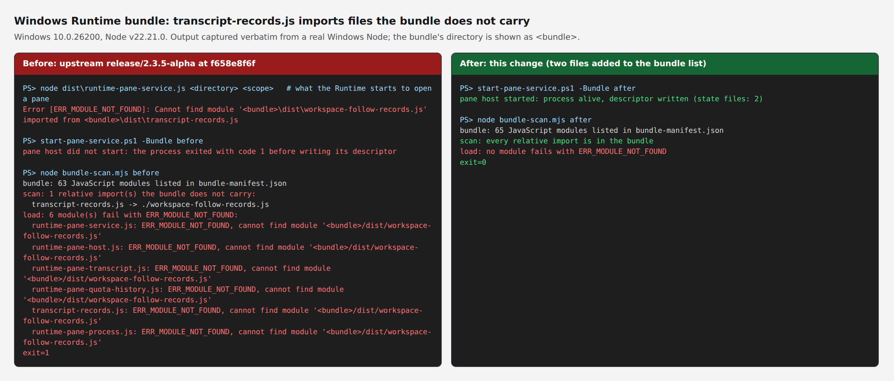

## What

On a Windows Runtime built from `release/2.3.5-alpha`, the pane host cannot start. Since #3281, `transcript-records.js` imports `workspace-follow-records.js`, which imports `workspace-follow-parse.js`. Neither file is in the bundle's module list, so `scripts/build-runtime.mjs` does not ship them, and six modules of the bundle fail to load with `ERR_MODULE_NOT_FOUND`: `runtime-pane-service.js`, `runtime-pane-host.js`, `runtime-pane-transcript.js`, `runtime-pane-quota-history.js`, `runtime-pane-process.js` and `transcript-records.js` itself. The Runtime opens a pane by starting `node runtime-pane-service.js` as a child process with its output discarded (`src/runtime-pane-link.ts`), and when that child exits before writing its descriptor, `RuntimePaneLink.open` throws `Pane host startup was not confirmed`. The server's own `dist/` has every file, so nothing on the server side shows it.

**Fix.** Both files join `RUNTIME_PANE_MODULES`, next to `transcript-records.js` (+2 entries). They import nothing but each other. The bundle's build id changes, as with any Runtime code change, so an existing Runtime picks the fix up through the usual update.

**Test.** `tests/runtime-bundle-closed.test.ts` builds the bundle from the sources (the portable compile the other bundle tests use, then `scripts/build-runtime.mjs`) and checks that everything its modules import (`import … from`, `import "…"`, `export … from`, `import()`) or start (`new URL("./file.js", import.meta.url)`) is a file the bundle carries, a Node built-in, or one of the Runtime's own packages. Three small tests keep the scanner honest: it passes what the bundle carries, it reports each kind of reference to a missing file, and it does not take a comment or a string for a reference.

**Scope.** `release/2.3.5-alpha` only: neither `workspace-follow-records.ts` nor the pane assets list exist on `main`. I searched the open and merged PRs and the history of `src/runtime-pane-assets.ts` (last changed before #3281) and found no fix at this base.

**Related.** I have a PR open that routes the CLI capability tables through one registry; its bundle test lists exactly this gap as a known one and fails on any other. Whichever of the two merges second drops that exception (one line there).

Before and after, on a real Windows Node (v22.21.0, Windows 10.0.26200); the bundle's directory is shown as `<bundle>`:

The scripts and the verbatim output are in [this evidence branch](https://github.com/Junsionloh/AgEnD/tree/c71f1e6817dea771b99e04da7ba67daaec838d41/runtime-bundle).

## Evidence

At `85ac22c44bcffba628cc6baebeed254e816b0246` on `f658e8f6f930522854843ce6c591434b9a182740` (`release/2.3.5-alpha`); `npm ci`, Node 22.23.4, Linux (WSL2) for the suite, Windows Node 22.21.0 for the pictures.

| Check | Result |
|---|---|
| `npx tsc --noEmit`, `npm run typecheck:tests`, `npm run build` | pass |
| `vitest run tests/runtime-bundle-closed.test.ts` | 4 tests pass |
| Runtime and bundle tests (`runtime-build-info`, `runtime-bundle-download`, `claude-auth-status`, `runtime-switches-m2255`, every `runtime-pane*`, `windows-cli*`, `runtime-update*` file) | 40 files, 716 tests pass |
| Full `vitest run`, 4 shards, built tree | 1811 files pass, 32,330 tests; 1 file fails: `tests/usage-antigravity-2122.test.ts` ("incremental: unchanged is not opened again", `TypeError: Cannot read properties of undefined (reading 'turns')`), the same failure and message on an unmodified `f658e8f6f` |
| Bundle built at the base, scanned and loaded module by module, on Windows Node | 63 modules; 1 relative import the bundle does not carry (`transcript-records.js -> ./workspace-follow-records.js`); 6 modules fail with `ERR_MODULE_NOT_FOUND` |
| The same at this HEAD | 65 modules; every relative import is in the bundle; no module fails |
| `dist\runtime-pane-service.js` started the way the Runtime starts it, on Windows Node | base: exits with code 1 before writing its descriptor, with `Cannot find module '<bundle>\dist\workspace-follow-records.js' imported from <bundle>\dist\transcript-records.js`. HEAD: stays up and writes its descriptor (stopped afterwards; only that process) |

Not run: a paired Windows Runtime opening a pane end to end (the child process was started by hand, the way `RuntimePaneLink.open` starts it), and the CI-only jobs.

**Reversal** (the new test must fail on the list as it was, and the new files must each be needed):

| Change | Result |
|---|---|
| Revert the two list entries | the closure test fails: `transcript-records.js → ./workspace-follow-records.js` |
| Keep `workspace-follow-records.js`, drop `workspace-follow-parse.js` | fails: `workspace-follow-records.js → ./workspace-follow-parse.js` |
| Both entries (this change) | passes |

## Checklist

- [x] Rows of `docs/dev/review-checklist.md` that apply are addressed: row 11 (the reversal table; the scanner has its own positive and negative controls) and row 12 (this HEAD, the platforms observed, what was not run). The other rows: N/A.
- [ ] A changelog entry under `changes/` (EN + zh-TW): added in a follow-up commit named after this PR's number.
- [x] UI changes only: N/A.
- [x] UI changes only: N/A.

🤖 Generated with [Claude Code](https://claude.com/claude-code)
